# FundenFlo Backend — Architecture Diagrams

> Living document. Any change that adds, renames, moves or removes a module, route group, queue, job, channel or worker updates the matching diagram here **and** [`inventory.md`](inventory.md) in the same change.
> **Built (M0 + M1.1 – M1.8c):** system context, identity & multiple logins (diagrams 3–4, parties/users/memberships/sessions parts), audit, notifications, outbox and the four M0 queues in diagram 9, the `catalog` module (diagram 2; feeds the Category and Requirement steps in diagram 7), the `attributes` module with the `conditions` and `facts` engines (diagram 2; the fact store and rule evaluation behind every step of diagram 7), and `config-publishing` + `questionnaires` with the `state-machines` and `questionnaire` engines (diagram 7: Pre-check step and the config lifecycle), `consents` with the `consents` engine (diagram 7: Consent step; diagram 5: consent gate before sharing), `partners` light with organization lifecycle (diagram 4: partner sign-in states; diagram 5: the CA pool routing will draw from), leads core: capture, lifecycle and the ops queue, and lead routing: versioned routing rules, the `assignment` engine, offers with accept deadlines, manual assign and revoke, and the `leads.route` queue, the CA lead inbox: masked offers, accept, decline, return, logged contact reveal, hand-over and lost, and the `sla` (generic timers, swept every 30 s) and `activities` (activity log, follow-ups) modules (diagrams 2, 5, 6 and 9, green parts). Everything else is planned. Design rationale: [`BACKEND_ARCHITECTURE_PLAN.md`](BACKEND_ARCHITECTURE_PLAN.md).
> Last updated: 2026-10-10

## Diagrams

1. [System context](#1-system-context)
2. [Module map](#2-module-map)
3. [Party, identity & lead model](#3-party-identity--lead-model)
4. [Single user, multiple logins](#4-single-user-multiple-logins)
5. [Lead capture → CA distribution](#5-lead-capture--ca-distribution)
6. [Lead & assignment state machines](#6-lead--assignment-state-machines)
7. [Borrower journey on the dynamic engines](#7-borrower-journey-on-the-dynamic-engines)
8. [Application & submission state machines](#8-application--submission-state-machines)
9. [Events, queues, workers & real-time](#9-events-queues-workers--real-time)

---

## 1. System context

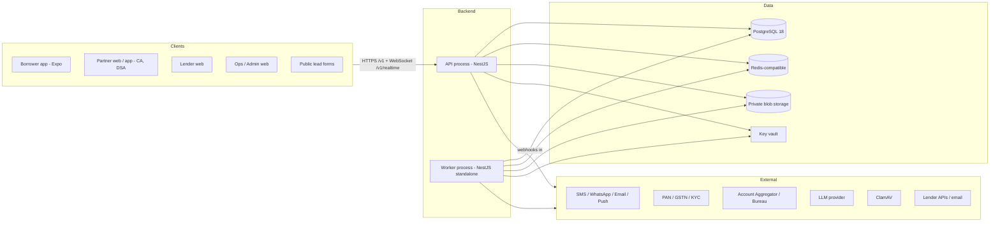

Hosting, networking and pipelines are owned by infra (Pradeep, Azure) and are not drawn here.

---

## 2. Module map

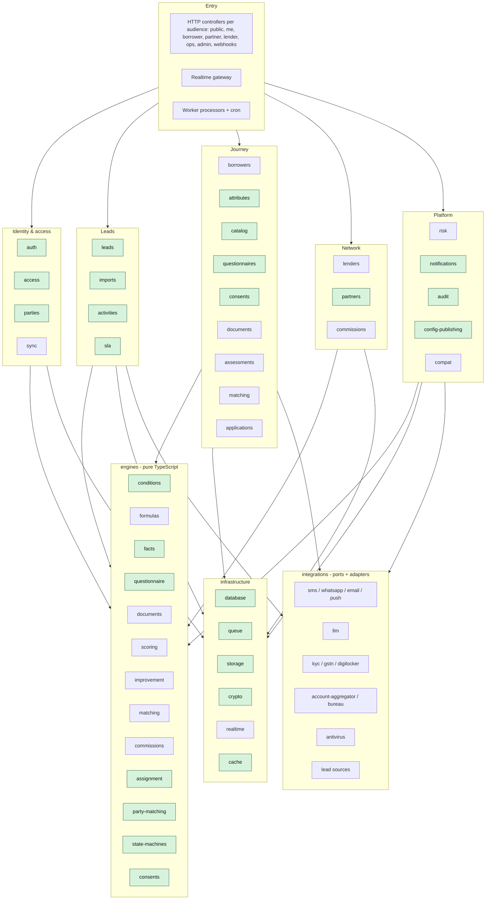

Green = built (M0 – M1.8c). Rules: engines import nothing from Nest, modules or infrastructure. Modules talk only through exported façade services or domain events. Integrations are reached only through ports.

---

## 3. Party, identity & lead model

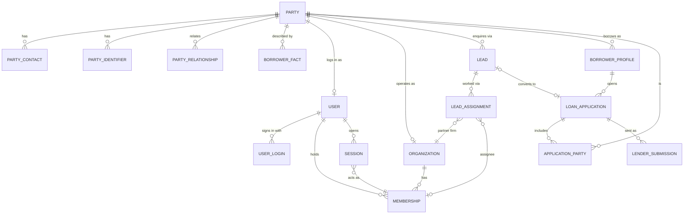

---

## 4. Single user, multiple logins

```mermaid
sequenceDiagram
  participant C as Client
  participant A as auth
  participant P as parties (resolver)
  participant M as access (memberships)
  participant S as sessions
  C->>A: POST /auth/otp/request {mobile | email, loginAs, referralCode?}
  A-->>C: {resendIn}
  C->>A: POST /auth/otp/verify {mobile | email, otp, device?}
  A->>P: resolve person party by mobile blind index
  P-->>A: existing party (e.g. a lead) or new party
  A->>M: membership for loginAs
  M->>M: accept pending invitations for this mobile or email
  alt loginAs = borrower
    M-->>A: personal borrower membership (created if missing)
  else loginAs = ca, dsa or lender with an active membership
    M-->>A: that membership
  else no matching membership
    M-->>A: none
  end
  A->>S: create session (device, IP, UA, membership or context none)
  A-->>C: tokens {sub, mid, ctx, rol, org, sid} + user + nextAction when ctx = none (PARTNER_NOT_ONBOARDED, PARTNER_PENDING_VERIFICATION, MEMBERSHIP_SUSPENDED, MEMBERSHIP_REQUIRED)
  C->>A: POST /auth/switch-context {membershipId} or {loginAs: borrower}
  A->>S: same session, new membership, refresh family rotated
  A-->>C: new tokens
  C->>A: POST /auth/token/refresh {refreshToken}
  A->>S: rotate; reuse of an old token revokes the session and family
```

Partner onboarding (built in M1.5): the partner organization and its owner membership move together.

```mermaid
stateDiagram-v2
  [*] --> pending: POST /partner/signup (org pending, owner membership pending)
  pending --> in_review: staff A recommends (approve or reject)
  in_review --> verified: staff B approves (org active, owner active)
  in_review --> rejected: staff B rejects (org closed, owner revoked; may sign up again)
  verified --> suspended: suspend (member tokens revoked, sessions closed)
  suspended --> verified: reinstate (tokens restored)
```

---

## 5. Lead capture → CA distribution

```mermaid
flowchart LR
  subgraph Sources
    IMP[Backlog import]
    MAN[Ops manual entry]
    WEB[Public form]
    DROP[App drop-off detector]
    REF[Partner referral]
    HOOK[Ad / WhatsApp / IVR webhooks]
  end
  IMP --> CAP
  MAN --> CAP
  WEB --> CAP
  DROP --> CAP
  REF --> CAP
  HOOK --> CAP
  CAP[LeadCaptureService] --> RES{Party resolver}
  RES -->|certain match or new| LINK[Lead linked to party]
  RES -->|uncertain| MQ[Party match review queue]
  LINK --> FACTS[Answers stored as declared facts]
  LINK --> CONS{Valid consent or lawful basis?}
  CONS -->|no| CP[consent_pending queue]
  CP -->|consent granted| CONS
  CONS -->|yes| ROUTE[Routing rules + assignment engine]
  REF -.->|protected referral| ROUTE
  ROUTE -->|no rule, manual rule, no eligible CA or offer limit| OPSQ[Ops queue]
  OPSQ -->|manual or bulk assign| OFFER
  ROUTE --> OFFER[Assignment offered - PII masked]
  OFFER -->|accept deadline missed or revoked by ops| ROUTE
  OFFER -->|declined| ROUTE
  OFFER -->|accepted, first CA wins| WORK[CA works lead: reveal contact, hand-over, activities, follow-ups]
  WORK -->|ops closes lead or consent withdrawn| REVOKED[Assignment revoked]
  WORK -->|convert| APPL[Loan application on the same party]
  WORK -->|offline conversion| OFF[Offline outcome recorded]
  WORK -->|lost| LOST[Lost with reason]
  WORK -->|returned| ROUTE
  APPL -->|application events| DERIVE[Lead status derived: converted / won / lost]
  classDef built fill:#d8f3dc,stroke:#2d6a4f,color:#081c15
  class IMP,MAN,WEB,DROP,CAP,RES,LINK,MQ,FACTS,CONS,CP,ROUTE,OPSQ,OFFER,WORK,LOST,REVOKED built
```

Green = built in M1.6a/b, M1.7 and M1.8a: backlog CSV/XLSX imports (upload URL → inspect → map → validate → commit → undo, in the worker), ops entry, the API-key website intake and app drop-offs (delayed check after a borrower sign-up) go through `LeadCaptureService` (person matching with a name check, catalog/city/amount resolution, 30-day dedupe flag, consent and lead-capture answers, quality score, encrypted raw payload). `consent_pending` is the `consentStatus=pending` filter on `GET /ops/leads`; ops can send an SMS consent link (`POST /ops/leads/:id/consent-request` → public `/public/consent-requests/:token`), and `leads.consent-sync` updates open leads whenever consent changes. Routing (M1.8a, `LeadRoutingService`): the worker routes a lead when it is captured, qualified or recycled, or gets consent; the first published routing rule whose `when` matches (by priority) draws verified, active, unpaused CAs from `PartnerService.routingPool` (service area, capabilities), keeps those the person lets `partner_sharing` cover, drops CAs at capacity or that already declined, missed or returned this lead, and offers it by the rule's strategy with accept and first-contact deadlines; a delayed `expire_offer` job moves a missed offer on. Ops can route, simulate, assign (also in bulk) and revoke. CA side (M1.8b, `/partner/leads`, `PartnerLeadService` → `LeadAssignmentService`): the inbox shows offers with the name shortened and contacts masked; accept locks the lead, re-checks consent and the deadline, withdraws parallel offers and starts the lead; decline and return send the lead on (outbox events → `leads.route`); contact reveal is logged per firm and moves the assignment to `working`; the owner can hand a lead to a firm member; lost completes the assignment. Ops status changes and per-CA consent withdrawal revoke active offers in the same transaction. M1.8c: deadlines are `sla_timers` rows (`SlaService`, handlers per kind via `@SlaHandlerFor`): the accept deadline expires the offer, the first-contact deadline warns (lead timeline) and then flags the lead `first_contact_missed` for ops; the first logged call, meeting or message satisfies it. CAs and ops log activities and follow-ups (`activities` module); staff activities stay private to staff; a closing assignment cancels its timers and the firm's open follow-ups. Notifications, offline conversion, CA lead edits and partner referrals come with M1.8d.

---

## 6. Lead & assignment state machines

Lead (built in M1.6a as `leadMachine`; `start` when a CA accepts, `recycle` when a CA returns the lead or ops revokes an in-progress assignment, `convert` from M3; any ops status change except `qualify` revokes active offers):

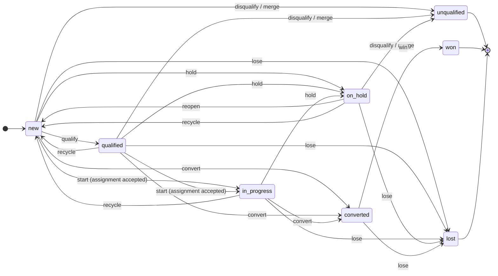

Assignment (built in M1.8a as `assignmentMachine`, every transition used from M1.8b through `LeadAssignmentService`; `offered`, `accepted` and `working` are the active states (`ACTIVE_ASSIGNMENT_STATES`), and a DB partial unique index allows one accepted or working assignment per lead; `start_work` happens on the first contact reveal, `complete` when the CA marks the lead lost):

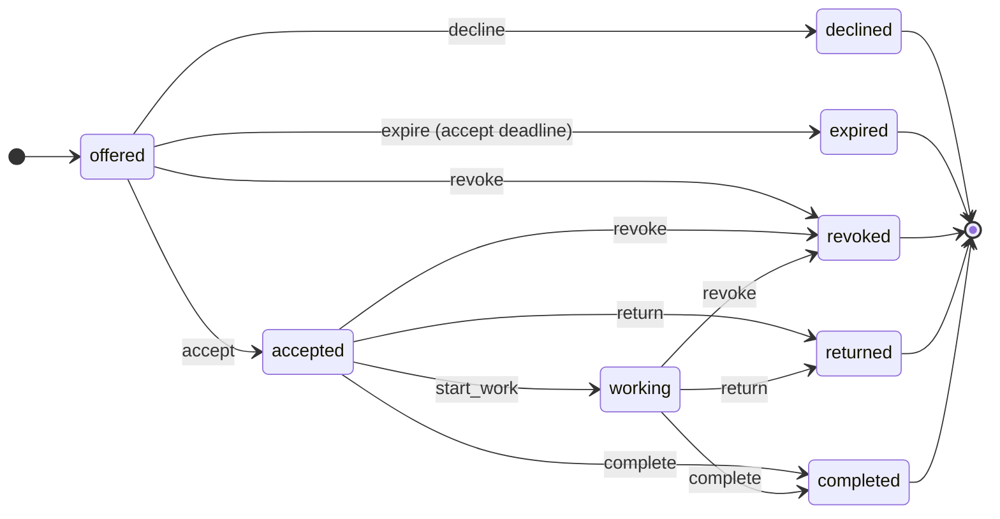

---

## 7. Borrower journey on the dynamic engines

```mermaid
flowchart LR
  S1[Category] -->|catalog + computed availability| S2[Requirement]
  S2 -->|category limits| S3[Pre-check]
  S3 -->|questionnaire engine + progressive profiling| S4[Consent]
  S4 -->|consent templates| S5[Documents]
  S5 -->|document requirement rules| S6[Extraction]
  S6 -->|facts with provenance| S7[Verify details]
  S7 -->|KYC port| S8[Score]
  S8 -->|scoring model| S9[Improvement plan]
  S8 --> S10[Matching]
  S10 -->|lender product rules| S11[Lender-specific questions and documents]
  S11 --> S12[Submission]
  S12 -->|lender events| S13[Sanction / disbursal]
  S13 -->|ledger| S14[Commission]
```

Every step reads and writes borrower data through one fact store and one rule format (built in M1.2):

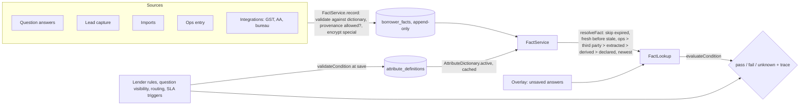

Every dynamic resource (question sets, consent templates and routing rules now; document requirements, lender products, scoring models, commission schemes next) shares one lifecycle (built in M1.3, `configVersionMachine` + `ConfigPublishingService`):

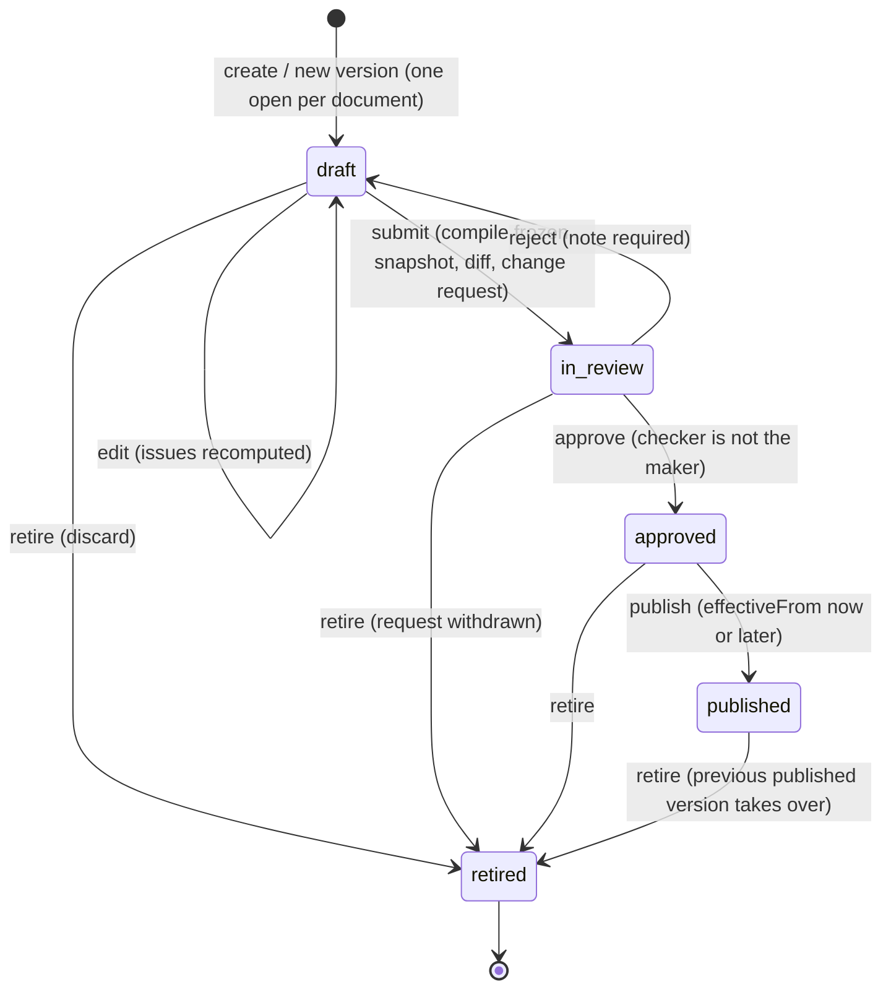

Active version = the published version with the latest `effectiveFrom` that has started. Consumers pin the version id (answers store `question_set_version_id`). Content is frozen by a DB trigger once submitted.

---

## 8. Application & submission state machines

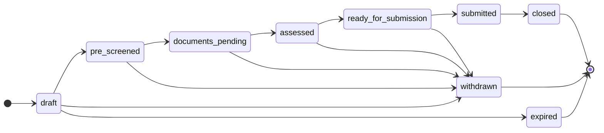

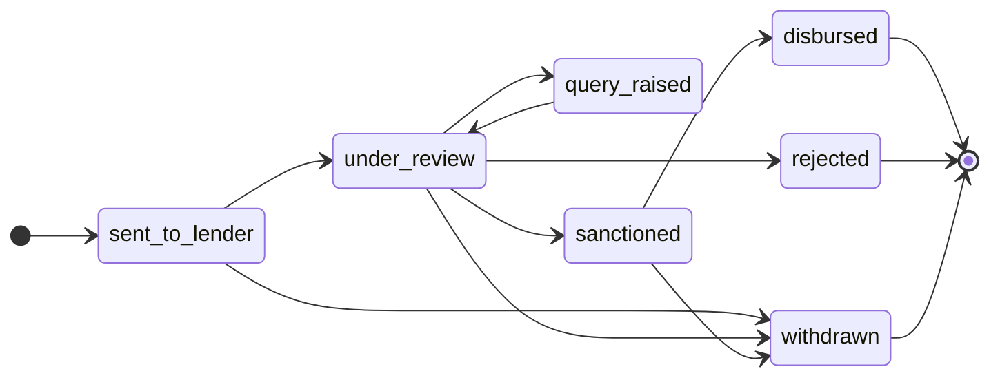

---

## 9. Events, queues, workers & real-time

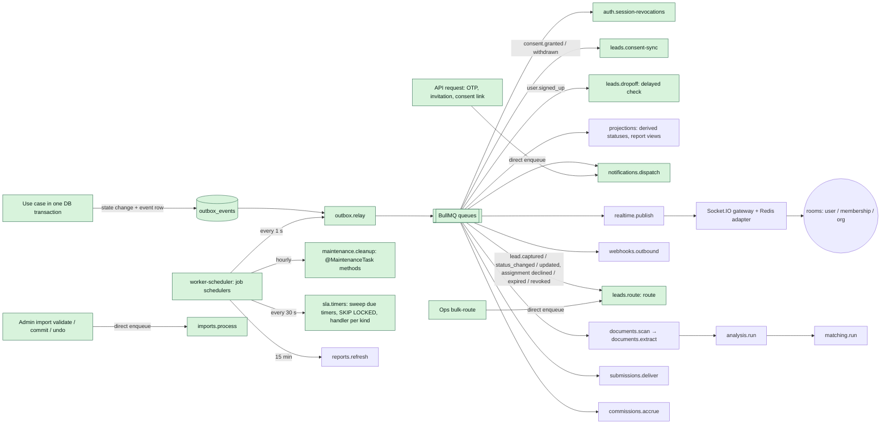

Queue and job details (producers, consumers, triggers) are in [`inventory/worker-queues-jobs.md`](inventory/worker-queues-jobs.md).
