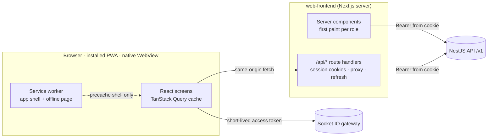

# FundenFlo Web Frontend — Architecture and Build Plan

> Written 2026-10-10. App folder: `web-frontend/`. Screen-by-screen map with the backend routes each screen calls: [`inventory/web-frontend.md`](inventory/web-frontend.md).
> The old Expo app in `frontend/` is not used or changed.

## 1. Goal

One web app that serves every FundenFlo user from the same URL:

- as a **website** on desktop and mobile browsers,
- as an **installable PWA** (home-screen icon, full screen, offline fallback),
- inside a **native wrapper app** later, which only loads the URL in a WebView (no second frontend to build).

It covers all seven areas: public pages, borrower, partner (CA/DSA), lender, ops, admin, finance and compliance. Every backend route meant for people is called by a screen; a coverage check fails the build if one is missed (section 7).

## 2. Stack

| Concern | Choice | Version (2026-10-10) |
|---|---|---|
| Framework | Next.js App Router, React Server Components, Turbopack | `next` 16.4.0, `react` 19.3.0 |
| Language | TypeScript, strict | 5.x |
| Styling | Tailwind CSS with design tokens in CSS variables; light and dark themes (`next-themes`) | `tailwindcss` 4.3.3 |
| Components | shadcn/ui source copied into `src/components/ui` (Radix primitives), restyled to the FundenFlo system; icons `lucide-react` | shadcn 4.21.4, `radix-ui` 1.7.0 |
| Data | TanStack Query on the client; server components for first paint | 5.104.1 |
| Forms | React Hook Form + Zod (same Zod major as the backend) | 7.89.0 / `zod` 4.6.5 |
| Text | `next-intl`; English catalogue is the source; other languages generated (section 6) | 4.14.9 |
| Toasts | `sonner` (never `alert`) | 2.0.8 |
| PWA | Web app manifest (`app/manifest.ts`) + Serwist service worker | `@serwist/turbopack` 9.5.13 |
| Realtime | Socket.IO client to the API gateway | 4.8.4 (server 4.8.3) |
| Tests | Vitest + Testing Library (units), Playwright (end to end, desktop and phone viewports) | 5.0.3 / 1.64.0 |
| Lint | oxlint + `tsc --noEmit`, same as the backend | — |

Project rules that apply to every screen: no code comments; Tailwind margins and paddings stay at `*-4` or below (larger gaps come from layout, e.g. `gap-*`, `space-*` and grid); enums and constants live in constants files; messages go through toasts or inline errors.

## 3. Architecture



### 3.1 Sessions (backend-for-frontend)

- The browser never stores tokens in JavaScript storage. Sign-in calls go to `web-frontend` route handlers, which call the API and keep the access and refresh tokens in `httpOnly`, `Secure`, `SameSite=Lax` cookies.
- Every client request goes to `/api/v1/...` on the same origin; the handler adds `Authorization: Bearer`, forwards `If-Match`, `Idempotency-Key` and `X-Request-Id`, streams uploads, and passes the JSON error body through unchanged.
- On `TOKEN_EXPIRED` the handler refreshes once (refresh rotation with reuse detection stays on the backend) and retries; on `REFRESH_TOKEN_REUSED`, `SESSION_REVOKED` or `USER_SUSPENDED` it clears the cookies and sends the user to sign-in.
- Mutating requests are checked for a same-origin `Origin` header (CSRF), on top of `SameSite`.
- Socket.IO needs a token in the browser: `/api/session/socket-token` returns the current access token (15 minutes), only to the same origin.
- One device can hold several contexts (borrower, partner firm, lender, staff). `/me` lists the memberships; the context switcher calls `POST /auth/switch-context` and reloads the shell for the new role.

### 3.2 Folder structure

```
web-frontend/
  src/app/
    (public)/            landing, sign-in, staff sign-in + MFA, invitation, consent link, offline
    (borrower)/app/      borrower home and the application journey
    (partner)/partner/   CA/DSA portal
    (lender)/lender/     lender portal
    (staff)/ops|admin|finance/  staff console (one shell, menu by role)
    account/             profile, security, consents, notifications, privacy (every context)
    api/                 session and proxy route handlers
    manifest.ts  sw.ts  layout.tsx
  src/components/ui/     design system primitives
  src/components/<area>/ shared building blocks per area (journey steps, lead card, versioned config editor …)
  src/lib/api/           typed client per backend module + endpoint registry
  src/lib/session/       cookie names, refresh, context
  src/lib/constants/     enums mirrored from the backend, nav per role, query keys, limits
  src/messages/          en.json (source) + generated languages
  tests/e2e/             Playwright specs per role
```

### 3.3 Data, errors and forms

- **Typed client**: one file per backend module (`lib/api/applications.ts` …). Each function names its endpoint from the registry (`endpoint('GET /applications/:id')`), so the coverage check can see it. Response types mirror the backend view shapes.
- **Errors**: the backend returns `{ code, message, details, requestId }`. Field errors (`VALIDATION_FAILED` with `details[].path`) land on the form fields; everything else shows a toast with the message and the request id for support. `VERSION_CONFLICT` offers "reload"; `403` shows a "no access" page; `RATE_LIMITED` / `OTP_COOLDOWN` show the wait time.
- **Concurrency**: edits send `If-Match: "<version>"`; creates that support it send an `Idempotency-Key`.
- **Lists**: cursor pagination (`items`, `nextCursor`) with "load more" on phones and paged tables on desktop.
- **Realtime**: socket events invalidate the matching queries (documents scanned, submission status, lead offers …) and raise a toast; `GET /sync/changes` catches up after the socket reconnects.
- **Uploads**: multipart through the proxy with progress; downloads open the backend's 5-minute signed URL.

### 3.4 Navigation and roles

- Contexts: `borrower`, `partner` (owner, agent), `lender` (admin, manager, user), `staff` (super admin, ops lead, ops reviewer, credit analyst, finance, compliance officer, support).
- The menu per role is a constants map that mirrors `backend/src/modules/access/domain/permissions.ts`; the backend still decides every request, so a hidden link is convenience, not security.
- Phones: bottom tab bar (4–5 primary items) + "more" sheet; tablets and desktops: collapsible sidebar. Tables become cards below `md`.

### 3.5 Responsive, PWA and native wrapper

- Mobile-first layouts, 44 px touch targets, `env(safe-area-inset-*)` padding for notches and the WebView, no hover-only actions.
- Manifest: name, icons (192, 512, maskable), theme colours for light and dark, `display: standalone`, start URL per last context.
- Service worker: precaches the app shell, fonts and icons; pages are network-first with the offline page as fallback; **API responses are never cached** (personal and financial data). An "update available" toast reloads into the new version.
- Native wrapper bridge (for later): if `window.ReactNativeWebView` exists, the app asks the wrapper for its Expo push token and registers it with `PUT /me/sessions/current/push-token`; file inputs and downloads use standard browser behaviour that WebViews support.

## 4. Design system

- FundenFlo green as the primary colour, neutral greys, semantic colours for success, warning, danger and info; every colour is a token with a dark-mode value.
- Inter for text (Devanagari and other Indian scripts fall back to Noto Sans), tabular numbers for money.
- Components: button, input, OTP input, select, combobox, date picker, checkbox, radio, switch, textarea, file drop zone, card, table, data list, tabs, dialog, sheet, drawer, toast, badge, status pill, progress steps, empty state, skeleton, avatar, breadcrumb, pagination, money and date formatters (₹ with Indian digit grouping, IST).
- Building blocks reused across roles: journey stepper, document checklist, status timeline, versioned config editor (draft → submit → approve → publish → retire), conditions builder, JSON diff viewer, audit trail, assignment card.
- The first screens (sign-in, borrower home, application start, partner dashboard, ops leads) are reviewed by the owner before the rest are built.

## 5. Screens

Full table: [`inventory/web-frontend.md`](inventory/web-frontend.md). Summary:

| Area | Screens | Backend routes |
|---|---|---|
| Public (landing, OTP sign-in, staff sign-in + MFA, invitation, consent link, offline, session handling) | 7 | 13 |
| Account (profile, security and logins, consents, notifications, privacy, switch role, realtime catch-up and push bridge) | 7 | 22 |
| Borrower (home, profile + PAN, application journey: start, requirement, questions, people, consents, documents, assessment, matches, submissions, timeline) | 13 | 45 |
| Partner (sign-up, dashboard, leads inbox and detail, follow-ups, own leads, clients and filed applications, referrals, disputes, commissions, team, profile and KYC, settings) | 14 | 38 |
| Lender (submissions inbox and detail, products, change requests) | 4 | 7 |
| Ops (leads, follow-ups, conversions, reports, cases, document review, signals, submissions, parties, disputes, risk, data requests) | 17 | 65 |
| Admin (users, invitations, audit, catalog, attributes and conditions, questionnaires, change requests, consents, notification templates, imports, lead sources and API clients, routing, partners, lenders and products, documents, scoring, commission schemes) | 24 | 170 |
| Finance (receivables, payouts, reconciliation, trial balance) | 4 | 11 |
| **Total** (some catalog routes are shared by several screens) | **90** | **367** |

## 6. Languages

- All interface text lives in `src/messages/en.json`; screens never hard-code strings.
- `pnpm i18n:translate` sends new or changed English strings to the Google Cloud Translation API and writes `hi`, `bn`, `mr`, `gu`, `ta`, `te`, `kn`, `ml`, `pa`, `or` catalogues (key `GOOGLE_TRANSLATE_API_KEY`, never committed). Generated files are reviewed like code; a hand-corrected string is kept on the next run.
- The language menu sets the user's language (`PATCH /me/profile` `preferredLanguage`, which also drives SMS and push language).
- Consent texts, document names and other backend content are shown in the backend's own locale and marked `translate="no"`: the backend records the exact consent text shown (template version and text hash), so it must not be rewritten in the browser.
- The in-page Google Translate widget is not used: it rewrites the page's DOM, which breaks React updates, and it would alter recorded consent text.

## 7. Connecting every API

- `src/lib/api/endpoints.ts` is the registry: `METHOD /path` for every backend route the app uses.
- `pnpm api:coverage` reads the backend route list (`docs/inventory/api-routes.md`, itself checked against the code by `pnpm inventory:check`) and fails when a route is neither in the registry nor in the exclusion list.
- Exclusions, each with a reason: `/v0/*` (compat for the old app), `/health/*` (infrastructure), `POST /public/leads` (server-to-server with an API key), planned webhooks and direct-upload routes (not built).
- Playwright flows per role call the real local backend (seeded), on a desktop and a phone viewport.

## 8. Milestones

| # | Slice | Done when |
|---|---|---|
| W0 | Foundation: app, tokens and components, dark mode, BFF sessions, proxy and errors, endpoint registry and coverage check, PWA (manifest, service worker, offline, install and update prompts), text catalogue and translate script, shells per role, OTP and staff sign-in with MFA, invitation, context switch, account screens | Sign-in for every role works on phone and desktop; Lighthouse PWA installable; owner reviews the look |
| W1 | Borrower journey I: home, application start, requirement, pre-check questions, people and co-applicant OTP, consents, borrower profile and PAN | A borrower reaches "documents" from a fresh sign-up |
| W2 | Borrower journey II: documents (upload, checklist, requests), analysis and assessment, matches, submissions, timeline, withdraw, subscriptions, public consent link | A borrower submits to a lender end to end |
| W3 | Partner I: sign-up, dashboard, leads inbox and detail, activities, follow-ups, own leads, offline conversion, convert to application | A CA accepts a lead and converts it |
| W4 | Partner II: clients and filed applications (journey in partner mode, borrower consent OTP), referrals and codes, commissions, team, profile, KYC, capacity, service areas, disputes | A CA files a case and sees commission |
| W5 | Lender portal | A lender acknowledges, queries, sanctions and disburses a submission |
| W6 | Ops console | Ops can work leads, cases, document review, submissions, parties, risk and data requests |
| W7 | Admin: users, access, audit, catalog, attributes, questionnaires, consents, notifications, imports, lead sources, routing, partners, lenders, products, documents, scoring, commission schemes, change requests | Every admin and versioned config route is used from a screen |
| W8 | Finance, polish and gates | `pnpm api:coverage` passes with 0 missing; all Playwright flows pass on both viewports; accessibility and Lighthouse checks pass |

## 9. Backend notes found while planning

- Push notifications are Expo-only; a website or PWA gets realtime toasts and in-app badges. Browser web push would need a backend channel (VAPID keys and a `webpush` sender) and is not planned.
- The web origin must be allowed by the API's CORS settings only for the Socket.IO connection; other calls are server to server through the BFF.
- The direct-upload routes (`/documents/upload-url`, `/documents/:id/complete`) are still planned; uploads go through the proxy.
